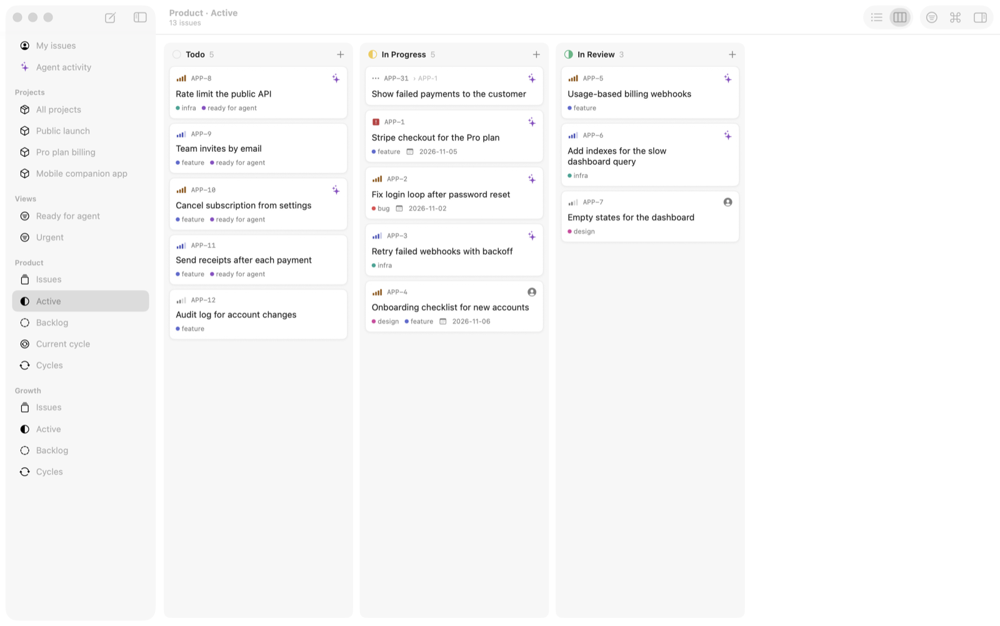
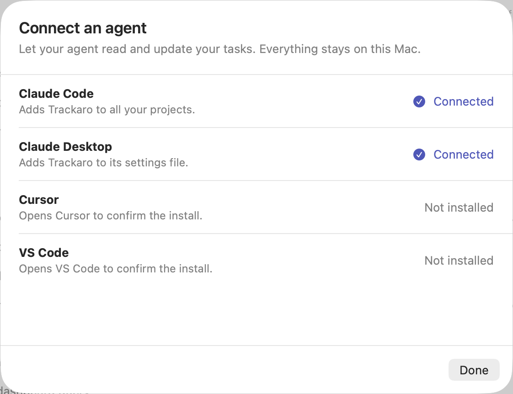
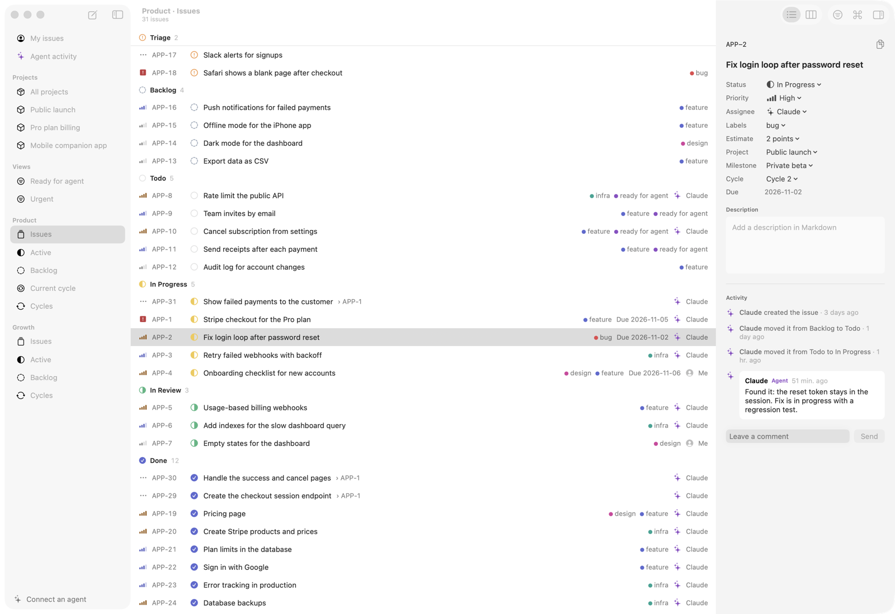
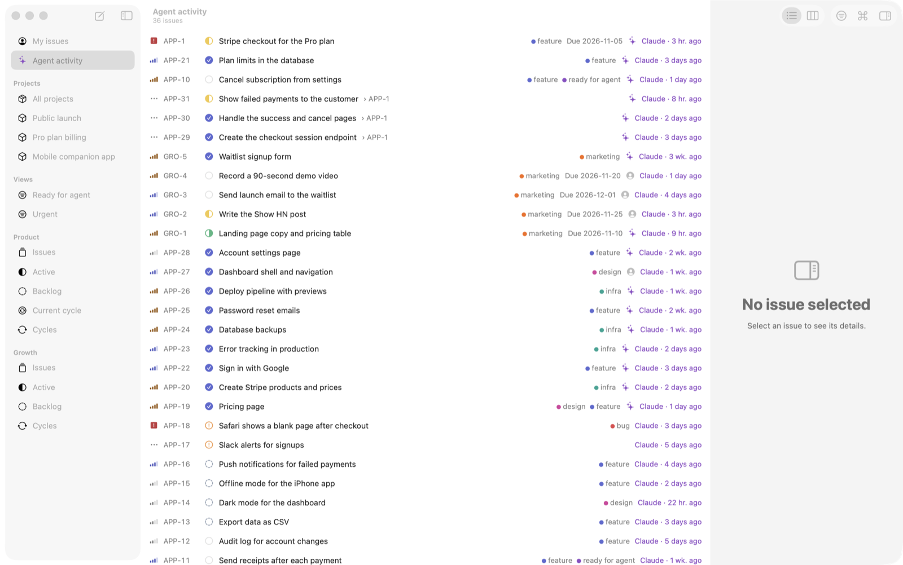
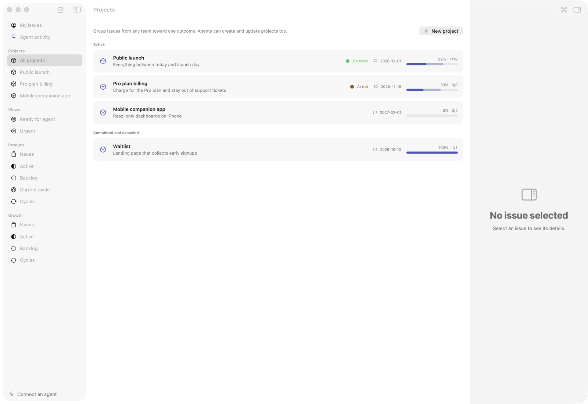
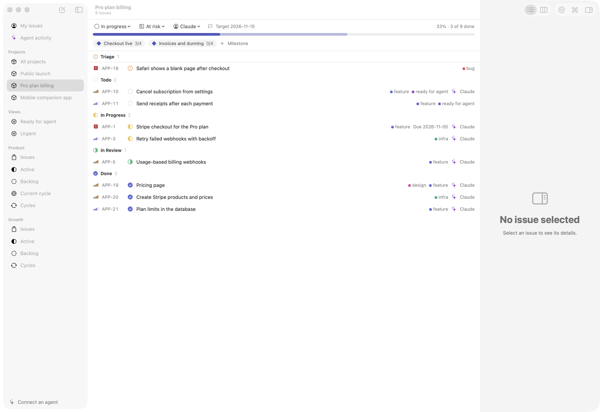
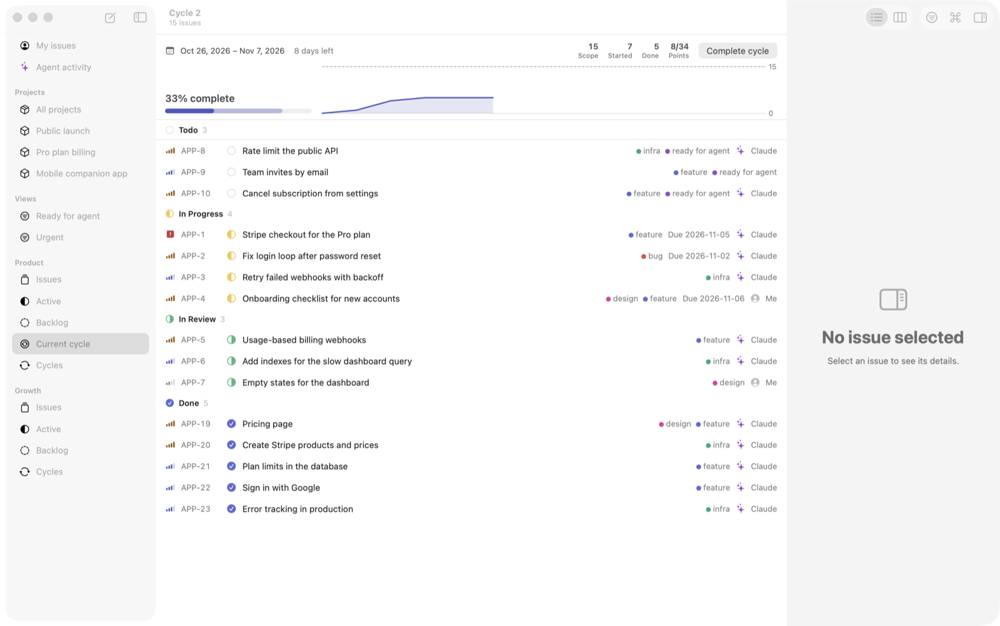
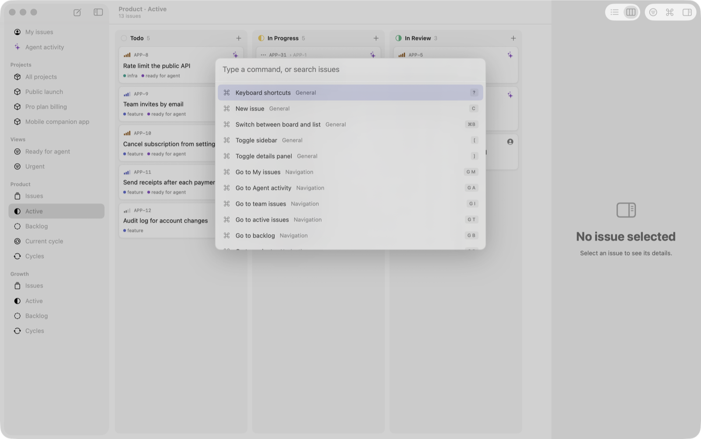
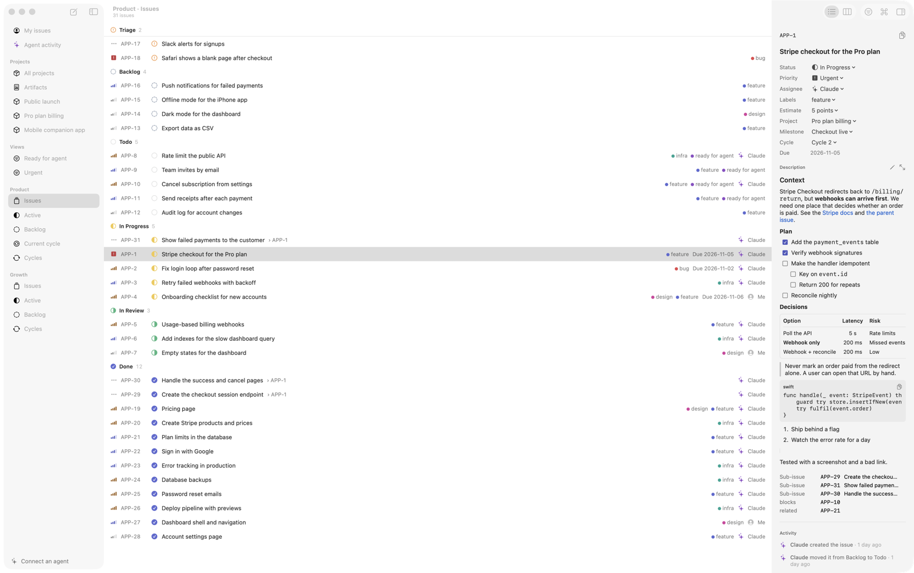
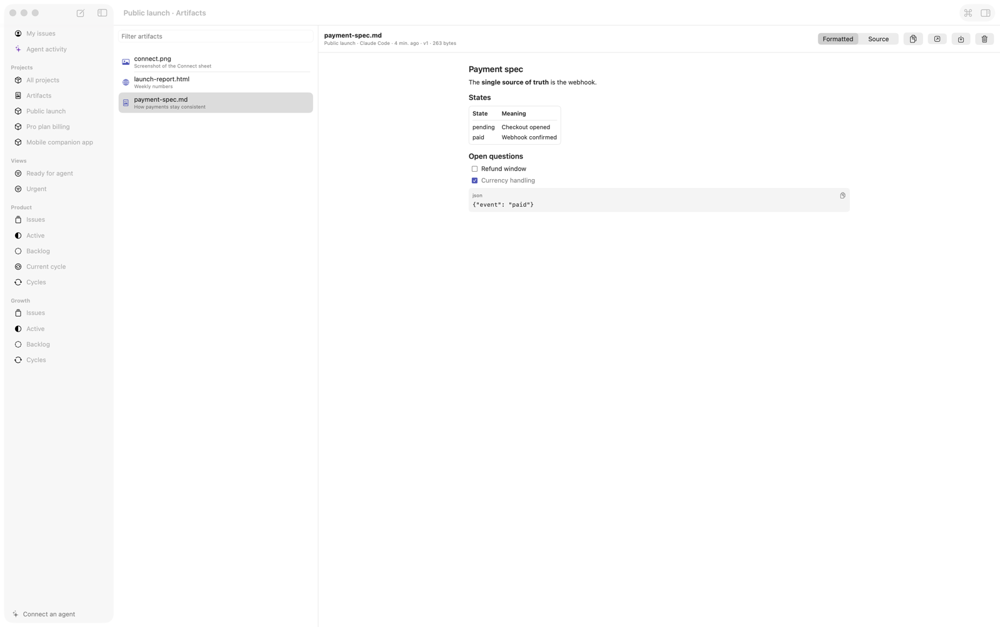

<div align="center">


# Trackaro

**The local task tracker for solo founders who build with Claude.**

Your AI agent reads and updates your tasks over MCP. You watch the progress live in a native Mac app.<br>
No account, no server, no cloud. Just one SQLite file on your Mac.


[Why local](#why-local) · [Install](#install) · [Connect Claude](#connect-claude) · [MCP tools](#mcp-tools) · [Features](#features) · [Backups](#backups-and-upgrades)

<br>

<picture>
  <source media="(prefers-color-scheme: dark)" srcset="docs/images/hero-dark.png">
  
</picture>

</div>

## Why local

When you work alone, a cloud issue tracker solves problems you don't have. There is no team to sync with, no one to
give permissions to and no seats to pay for. What you do get is another account, and a network trip every time your
agent checks what to do next.

In the AI era, speed is the advantage. So I built the tracker to live next to the agent instead of on someone else's
server:

| | Cloud tracker | Trackaro |
| --- | --- | --- |
| **Where your tasks live** | A vendor's servers | One SQLite file on your Mac |
| **How your agent reaches them** | Over the internet | A local process, about 12 ms per call[^1] |
| **Setup** | Account, workspace, API key or OAuth | One command |
| **Built for** | Teams | One founder and their agents |

[^1]: Median of 200 calls each to `search_issues`, `get_workspace` and `get_issues`, on a small workspace on an Apple
    Silicon Mac. Your numbers will vary with the size of your workspace.

## How it works

```
   You                                       Claude Code, Cursor, any MCP client
    │                                                       │
    ▼                                                       ▼
 Trackaro.app  ──────►  trackaro.sqlite  ◄──────  trackaro-mcp
 native Mac app          on your Mac               local MCP server
```

- **The agent works through tools.** It finds issues, starts them, comments on what it did and moves them along.
- **You see it happen.** The app picks up agent changes within a third of a second, and every change is recorded
  under the agent's name.
- **It goes both ways.** Move a card or leave a comment, and Claude can [hear about it](docs/agent-pings.md) and react.
- **The app can stay closed.** The server opens the same file directly, so agents work whether or not the app is
  running.

## Install

You need macOS 14 or later. [Download the latest `.dmg`](https://github.com/tecbay/trakaro/releases/latest/download/Trackaro-0.2.0.dmg)
and drag Trackaro to Applications.

The download isn't notarized yet, so macOS blocks it on first open. Allow it under **System Settings → Privacy &
Security → Open Anyway**, or run:

```bash
xattr -dr com.apple.quarantine /Applications/Trackaro.app
```

### Build from source

You need Xcode 16 or later and [XcodeGen](https://github.com/yonaskolb/XcodeGen) (`brew install xcodegen`):

```bash
git clone https://github.com/tecbay/trakaro.git
```

```bash
cd trakaro
```

```bash
scripts/make-dmg.sh
```

```bash
open dist/Trackaro-0.2.0.dmg
```

Drag Trackaro to Applications. The app is a universal binary for Apple Silicon and Intel, and the MCP server is
bundled inside it.

> [!NOTE]
> The script signs ad hoc by default, because the project has no Developer ID certificate yet. To produce a signed,
> notarized build, run it with your own `SIGN_IDENTITY` and `NOTARY_PROFILE`; the top of
> [`scripts/make-dmg.sh`](scripts/make-dmg.sh) shows how.

## Connect Claude

Click **Connect an agent** at the bottom of the sidebar, then **Connect** next to your tool. It also works from the
`⌘K` palette.

<p align="center">
  
</p>

| Tool | What the button does |
| --- | --- |
| **Claude Code** | Runs `claude mcp add` for you. Restart any running sessions. |
| **Claude Desktop** | Adds Trackaro to its settings file and keeps a backup. Quit and reopen Claude Desktop. |
| **Cursor** | Opens Cursor to confirm the install. |
| **VS Code** | Opens VS Code to confirm the install. |

Prefer the terminal? This does the same for Claude Code:

```bash
claude mcp add --scope user trackaro -- /Applications/Trackaro.app/Contents/Helpers/trackaro-mcp
```

Then just talk to it:

> Create a team called Product with the key APP, then break the Stripe integration into sub-issues.

> What's on my plate? Pick the most urgent issue and start on it.

> Give me a standup of what moved since yesterday.

To set up Cursor by hand, add this to `~/.cursor/mcp.json`:

```json
{
  "mcpServers": {
    "trackaro": { "command": "/Applications/Trackaro.app/Contents/Helpers/trackaro-mcp" }
  }
}
```

### Server options

| Option | What it does |
| --- | --- |
| `--channel` | Pushes your changes into Claude Code as they happen. See [agent pings](docs/agent-pings.md). |
| `--read-only` | Hides every tool that writes. |
| `--agent-name "Claude (backend)"` | Records changes under a custom name. |
| `--database PATH` | Uses another database file. `TRACKARO_DATABASE` does the same. |

## MCP tools

30 tools, designed so an agent can use them without guessing and without wasting tokens.

| Area | Tools |
| --- | --- |
| **Orientation** | `get_workspace` |
| **Issues** | `search_issues` `get_issues` `create_issue` `create_sub_issues` `update_issue` `move_issue` `bulk_update_issues` `archive_issue` |
| **Conversation** | `add_comment` `list_comments` `get_issue_history` `set_relation` `remove_relation` `mark_duplicate` |
| **Planning** | `list_projects` `create_project` `update_project` `create_milestone` `list_cycles` `create_cycle` `cycle_progress` |
| **Views** | `save_view` `delete_view` |
| **Artifacts** | `save_artifact` `list_artifacts` `get_artifact` `delete_artifact` |
| **Setup** | `create_label` `create_team` |

**Resources:** `trackaro://workspace`, `trackaro://cycles/active`, `trackaro://issue/{identifier}`<br>
**Prompts:** `standup`, `triage`, `plan_work`

What makes them pleasant for an agent:

- **Names in, names out.** Tools accept `ENG-42`, `"In Progress"`, `"me"` (you) and `"self"` (the agent).
- **Misses teach.** A name that matches nothing returns the valid options, so the agent corrects itself.
- **Omitted stays, null clears.** The same rule in every tool.
- **Batches are all or nothing.** Every item is checked first, so one bad name writes nothing.
- **Compact output.** Minified JSON with empty fields dropped. Listing tools return summaries.
- **Safe undo.** Undo in the app refuses rather than overwrite an agent's newer change.

## Features

<table>
  <tr>
    <td width="50%"><p align="center"><b>Issues:</b> see everything Claude did and said</p></td>
    <td width="50%"><p align="center"><b>Agent activity:</b> every issue your agents changed</p></td>
  </tr>
  <tr>
    <td><p align="center"><b>Projects:</b> health, targets and progress</p></td>
    <td><p align="center"><b>Milestones:</b> one project at a glance</p></td>
  </tr>
  <tr>
    <td><p align="center"><b>Cycles:</b> scope, points and burn-up</p></td>
    <td><p align="center"><b>Command palette:</b> <code>⌘K</code> for everything</p></td>
  </tr>
  <tr>
    <td><p align="center"><b>Rich descriptions:</b> the context Claude writes, formatted</p></td>
    <td><p align="center"><b>Artifacts:</b> specs and reports, kept with the project</p></td>
  </tr>
</table>

<p align="center"><sub>Screenshots use made-up demo data.</sub></p>

- **Rich descriptions:** Claude writes GitHub-flavored Markdown with headings, task lists, tables and code blocks. You read
  it formatted, and edit it with a toolbar and a live preview.
- **Project artifacts:** Claude saves specs, reports, HTML pages, images and PDFs to a project, and you browse them in
  the app. HTML shows with its scripts off and nothing loaded from the network.
- **Backup and restore:** one file with everything in it, plus automatic daily copies.
- **One-click agent setup:** connect Claude Code, Claude Desktop, Cursor or VS Code from inside the app.
- **Issues:** sub-issues, labels, relations, comments, estimates, due dates and a full activity history.
- **Board and list:** `⌘B` switches views. Drag cards between columns and watch them animate when an agent moves them.
- **Keyboard first:** `⌘K` command palette, `S` `P` `A` `L` pickers, `g` chords, multi-select, and `?` for every shortcut.
- **Filters and saved views:** `F` to filter, `/` to search, `⌘S` to save. Agents can use and create views too.
- **Projects and cycles:** milestones, health, progress bars, burn-up charts and cycle rollover.
- **Column automations:** drop a card in a column and Trackaro runs `claude -p` in the repository you chose. Only your
  own moves trigger a rule, so agents can't set off loops.
- **Agent pings (prototype):** Claude Code channel push, Claude Code and Cursor hooks, or a live `watch` feed.
- **Deep links:** agents can hand you links like `trackaro://issue/ENG-42` that open the issue in the app.

## Your data

Everything lives in one file:

```
~/Library/Application Support/Trackaro/trackaro.sqlite
```

Trackaro has no accounts, no telemetry and no networking code. Two things do leave your Mac, and they come from your own tools rather than from Trackaro: your agent sends what it reads to its model
provider, and column automations run the shell command you configure.

## Backups and upgrades

Open **File → Backup and Restore…** to save a backup or restore one. A backup is one file holding all your issues,
projects, automations and artifacts. Column automations' log files are not included.

Trackaro also keeps copies in the `Backups` folder beside the database: one a day for the last 7 days, and one before
every upgrade or restore. A restore never touches your data until the backup has passed its checks, and agents that are
connected carry on with the restored data.

To upgrade:

1. Quit Trackaro and drag the new version to Applications. Your data stays where it is.
2. Open Trackaro. It copies your database to `Backups`, then upgrades it.
3. Restart your agent sessions to get the new tools. Sessions still running the old server keep working until then.

If you need to go back, reinstall the older version. It can still open an upgraded database and simply ignores what it
doesn't know about.

## Develop

```bash
swift test
```

```bash
cd App && xcodegen generate && open Trackaro.xcodeproj
```

The core, MCP server and UI logic are plain Swift packages with tests, and the SwiftUI app sits on top.
[`CLAUDE.md`](CLAUDE.md) holds the project rules, and the
[`trackaro-architecture`](.claude/skills/trackaro-architecture/SKILL.md) skill maps the code. Use `TRACKARO_DATABASE`
when testing by hand so your real tasks stay untouched.

## Roadmap

- [x] Local store and MCP server
- [x] Native app with keyboard layer and undo
- [x] Board, filters, saved views, projects and cycles
- [x] Column automations and agent pings
- [x] `.dmg` build and downloadable release
- [x] Rich descriptions, project artifacts, backup and restore
- [ ] Notes, local inbox and reminders
- [ ] Developer ID signing and notarization

## License

[MIT](LICENSE)
